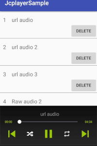

[](https://jitpack.io/#josef130/JcPlayer)
</br></br>

<h1 align=center>

</h1>

A simple audio player for Android that you can plugin to your apps quickly get audio playback working.
</br></br>



## New features
- Raw files
- Asset Files
- Custom layout

## Tested files
- http://xxxx/abc.mp3

## Not tested URLs
- http://xxxx/abc.m4a
- http://xxxx:1232
- http://xxxx/abc.pls
- http://xxxx/abc.ram
- http://xxxx/abc.wax
- rtmp://xxxx
- http://xxxx/abc.aspx
- http://xxxx/abc.php
- http://xxxx/abc.html
- mms://xxxx

## Support us

You can support us by becoming a patron on Patreon, any support is much appreciated.

[](https://www.patreon.com/josef130)


## Gradle Dependency (Project level)
```Gradle
allprojects {
	repositories {
		jcenter()
	        maven { url "https://jitpack.io" }
	    }
	}
```
## Gradle Dependency (Module level)
```Gradle
dependencies {
    // ... other dependencies
     implementation 'com.github.josef130:JcPlayer:2.8.4'
}
```


## Android system media integration (2.8.2 pre-release)

The media card uses a large white music-note placeholder, cached once at 256x256 pixels. A fixed total-duration subtitle replaces the repeated application name, while the system owns the seek/progress display. Dedicated 24dp vector actions improve Android 12 presentation; the final control size and panel colors depend on the OS/device.

Playback now uses a MediaSessionCompat, a standard MediaStyle notification and a mediaPlayback foreground service. Android chooses the panel appearance. Track title, duration, progress, play/pause, previous/next and seek are published to system controls. Lock-screen visibility depends on the device's notification/privacy settings.

Audio focus is requested before playing. Another music application's permanent focus takeover pauses JcPlayer without automatic restart. A temporary interruption can resume when focus returns, unless the user paused or stopped. Disconnecting headphones also pauses playback.

The service owns background playback. Do not call `kill()` from Activity `onDestroy()` if playback should continue when leaving the screen. Call it when the user explicitly ends playback. Existing notification methods and custom small-icon selection remain supported; custom RemoteViews layouts are replaced by system media controls.

The library manifest supplies `FOREGROUND_SERVICE`, `FOREGROUND_SERVICE_MEDIA_PLAYBACK`, `WAKE_LOCK`, the mediaPlayback service type and media-button receiver. Start playback from a visible user action; Android foreground-service restrictions still apply. Media-session notifications are exempt from the Android 13 ordinary notification-permission gate. The minimum SDK remains 14 (Android 4.0).

This release retains MediaPlayer and AndroidX Media 1.6.0 rather than migrating the engine to Media3. It does not restore a playlist after process death or device reboot. The sample uses bundled audio for offline testing.

## Background queue continuity (2.8.2 pre-release)

Automatic advancement is owned by JcPlayerManager rather than JcPlayerView. The queue continues when the Activity is stopped/destroyed and no player view remains attached. The media foreground service and audio focus remain active across track boundaries, including repeat-one seeking; ending a non-repeating queue releases playback resources normally.

`JcPlayerManager.autoAdvance` defaults to true. Hosts that intentionally manage completion themselves can set it to false. A completion callback that already stops, replaces or replays the track will not be advanced again by the default queue logic.

Detached JcPlayerViews unregister their UI callbacks and reattach without starting audio. Hosts should also call `manager.removeListener(activityListener)` when an Activity is destroyed. This removes UI callbacks without stopping the service or clearing the playlist.
## Getting Started
You only need  a JcPlayerView on your Layout Activity/Fragment. All the controls and everything else are created by the player view itself.
```xml
<com.example.jean.jcplayer.view.JcPlayerView
    android:id="@+id/jcplayer"
    android:layout_width="match_parent"
    android:layout_height="match_parent"/>
```

## Code Setup
#### Find your JcPlayerView xml and...
```java
    jcplayerView = (JcPlayerView) findViewById(R.id.jcplayerView);
```

### Option 1: Just init a playlist
```java
    ArrayList<JcAudio> jcAudios = new ArrayList<>();
    jcAudios.add(JcAudio.createFromURL("url audio","http://xxx/audio.mp3"));
        jcAudios.add(JcAudio.createFromAssets("Asset audio", "audio.mp3"));
        jcAudios.add(JcAudio.createFromRaw("Raw audio", R.raw.audio));

        jcplayerView.initPlaylist(jcAudios, null);
```

### Option 2: Initialize an anonymous playlist with a default title for all
```java
    jcplayerView.initAnonPlaylist(jcAudios);
```

### Option 3: Initialize an playlist with a custom title for all
```java    
    jcplayerView.initWithTitlePlaylist(urls, "Awesome music");
```

### Call the notification player where you want.
```java
    jcplayerView.createNotification(); // default icon
```
OR
```java
    jcplayerView.createNotification(R.drawable.myIcon); // Your icon resource
```

### Notification icon behavior (2.7.7+)

`createNotification()` uses `R.drawable.default_icon` unless a custom icon was already
selected. `createNotification(R.drawable.myIcon)` selects the small status-bar icon
and preserves it through play, pause, track/time updates and foreground/background
notification recreation. A later call without an argument keeps the selected icon.
Pass a white notification silhouette on a transparent background as your custom icon.
The artwork inside the notification layout remains independent of the small icon.
No OneSignal or OpenPush icon is selected by the notification code.

### Notification stability (2.8.2)

Notification work is serialized on the main looper, including calls from background
playback threads. Progress callbacks are coalesced and unchanged displayed seconds
are not reposted. Small notification icons are kept as resource references; they are
not decoded into an additional full-resolution large bitmap on each update.

If Android throws the reported ArraySet `ArrayIndexOutOfBoundsException` during
`notify()`, the player retries once using a simple system notification layout with
the same small icon. If that retry also fails, the update is skipped rather than
crashing playback. The normal custom artwork and controls are unchanged when posting
succeeds. Stopping the player cancels only its own notification.
### How can I get callbacks of player status?
```java
    MyActivity implements JcPlayerManagerListener {
        ....
    jcplayerView.setJcPlayerManagerListener(this);
    // Just be happy :D
}
```

## Custom layout
You can customize the player layout by manipulating these attributes.
```xml
        app:next_icon
    app:next_icon_color
    app:pause_icon
    app:pause_icon_color
    app:play_icon
    app:play_icon_color
    app:previous_icon
    app:previous_icon_color
    app:progress_color
    app:random_icon_color
    app:repeat_icon
    app:repeat_icon_color
    app:seek_bar_color
    app:text_audio_current_duration_color
    app:text_audio_duration_color
    app:text_audio_title_color
```
### Please, if you liked this project or help you to do your job, support me by being a sponsor <3

## TODO LIST ##
* [x] Set custom layouts for player.
* [ ] Add Instrumentation tests
* [ ] Add unit tests.


## Optional per-track media artwork (2.8.3 pre-release)

Configure once in Application.onCreate, before playback:

```java
JcPlayerManager.setArtworkProvider((applicationContext, audio) -> cachedSmallBitmapFor(audio));
```

The provider is called on the main thread on track changes, not progress ticks. Return an already available small bitmap, or null to use the existing default artwork. Do not capture an Activity or do network/disk work in this callback. Images larger than 256 pixels are scaled to a maximum side of 256. Do not recycle returned bitmaps while the player uses them. MediaSession metadata and the notification use the same cover. Changing the provider refreshes an active session without restarting playback; passing null restores the default. Calling the setter before playback does not create or bind a service. The existing small notification icon is independent of artwork and is unchanged.

## Queue replacement navigation (2.8.4 pre-release)

Next and previous now synchronize their cursor with the current audio before choosing a neighbor. This prevents skipping/repeating the wrong item after an application replaces its queue (for example, all songs to favorites) while the same song remains current or is resumed. No media session or player is recreated by this synchronization. Existing artwork, audio focus, background completion and repeat behavior are preserved.
